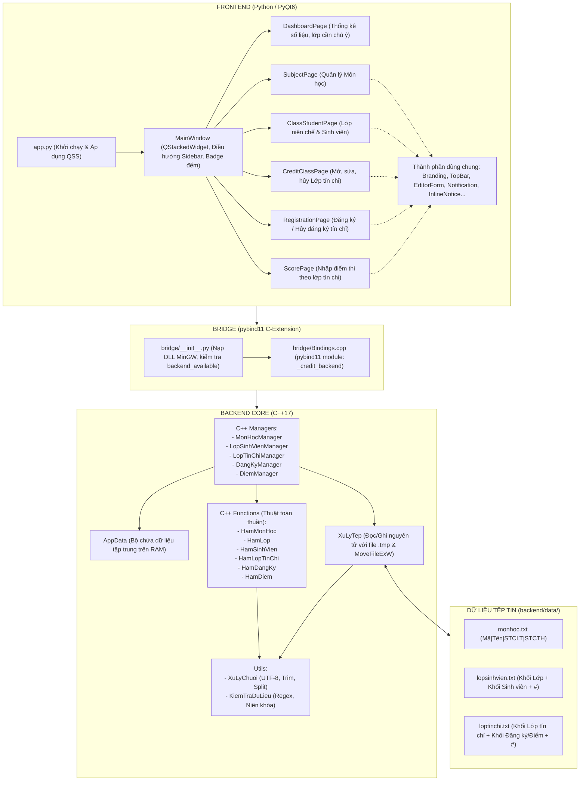

# TÀI LIỆU TOÀN DIỆN VỀ KIẾN TRÚC & MÃ NGUỒN DỰ ÁN QUẢN LÝ LỚP TÍN CHỈ (PTIT)

> **Mục đích tài liệu:** Bản tài liệu này đóng gói toàn bộ kiến trúc, cấu trúc dữ liệu giải thuật, định dạng file, quy tắc nghiệp vụ, tầng cầu nối (bridge) và giao diện người dùng của dự án `QuanLyLopTC`. Tài liệu được thiết kế để bất kỳ lập trình viên hoặc AI assistant nào khi đọc vào cũng nắm bắt 100% hệ thống mà không cần đọc lại toàn bộ mã nguồn.

---

## MỤC LỤC
1. [Tổng Quan Dự Án](#1-tổng-quan-dự-án)
2. [Sơ Đồ Kiến Trúc Hệ Thống](#2-sơ-đồ-kiến-trúc-hệ-thống)
3. [Cấu Trúc Thư Mục & Vai Trò Các Tệp](#3-cấu-trúc-thư-mục--vai-trò-các-tệp)
4. [Mô Hình Dữ Liệu & Cấu Trúc Giải Thuật (C++ Core)](#4-mô-hình-dữ-liệu--cấu-trúc-giải-thuật-c-core)
5. [Định Dạng Lưu Trữ & Cơ Chế I/O Tệp Tin](#5-định-dạng-lưu-trữ--cơ-chế-io-tệp-tin)
6. [Quy Tắc Nghiệp Vụ & Ràng Buộc Toàn Vẹn](#6-quy-tắc-nghiệp-vụ--ràng-buộc-toàn-vẹn)
7. [Tầng Cầu Nối C++ / Python (pybind11 Bridge)](#7-tầng-cầu-nối-c--python-pybind11-bridge)
8. [Kiến Trúc Giao Diện PyQt6 (Frontend)](#8-kiến-trúc-giao-diện-pyqt6-frontend)
9. [Quy Trình Xây Dựng, Chạy & Kiểm Thử](#9-quy-trình-xây-dựng-chạy--kiểm-thử)
10. [Lưu Ý Kỹ Thuật & Cạm Bẫy Cần Tránh (Gotchas)](#10-lưu-ý-kỹ-thuật--cạm-bẫy-cần-tránh-gotchas)

---

## 1. TỔNG QUAN DỰ ÁN

- **Tên dự án:** Quản lý đào tạo tín chỉ sinh viên (Học viện Công nghệ Bưu chính Viễn thông - PTIT).
- **Mục tiêu:** Xây dựng ứng dụng desktop phục vụ công tác quản lý môn học, lớp niên chế, sinh viên, mở lớp tín chỉ, đăng ký học phần và chấm điểm thi theo đúng chuẩn đồ án Cấu trúc Dữ liệu & Giải thuật.
- **Kiểu kiến trúc:** **Hybrid Architecture** (Đa ngôn ngữ):
  - **Backend Core (C++17):** Đảm nhiệm toàn bộ cấu trúc dữ liệu nâng cao (BST, Danh sách liên kết đơn, mảng tĩnh, mảng con trỏ), thuật toán kiểm tra ràng buộc nghiệp vụ, đọc/ghi tệp tin nguyên tử (atomic file writes).
  - **Interoperability Bridge (`pybind11`):** Biên dịch C++ core thành CPython C-Extension (`_credit_backend.pyd` trên Windows hoặc `.so` trên Linux).
  - **Frontend Client (Python 3.10+ / PyQt6):** Giao diện đồ họa hiện đại, responsive, tuân thủ nhận diện thương hiệu PTIT (đỏ mận `#C8102E`, xanh navy `#12345B`, trắng `#F8FAFC`), bảng kiểu dáng `ptit.qss`, các panel trượt (drawer) phi modal.

---

## 2. SƠ ĐỒ KIẾN TRÚC HỆ THỐNG



---

## 3. CẤU TRÚC THƯ MỤC & VAI TRÒ CÁC TỆP

```text
QuanLyLopTC/
│
├── app.py                         # Điểm vào ứng dụng PyQt6, nạp stylesheet ptit.qss, khởi tạo MainWindow
├── CMakeLists.txt                 # Cấu hình biên dịch thư viện C++ core, module pybind11 và các bài test CTest
├── build_backend.ps1              # Script PowerShell tự động dò tìm Python/MinGW/CMake, cài package và build extension
├── requirements.txt               # Thư viện Python phụ thuộc: PyQt6 >=6.6,<7 và pybind11 >=2.11,<4
├── README.md                      # Hướng dẫn cơ bản của repository
│
├── backend/                       # NGUỒN C++ BACKEND
│   ├── data/                      # 3 tệp dữ liệu phẳng định dạng UTF-8
│   │   ├── monhoc.txt             # Dữ liệu môn học
│   │   ├── lopsinhvien.txt        # Dữ liệu lớp niên chế lồng danh sách sinh viên
│   │   └── loptinchi.txt          # Dữ liệu lớp tín chỉ lồng danh sách sinh viên đăng ký & điểm
│   │
│   ├── include/                   # Headers C++
│   │   ├── model/
│   │   │   ├── KhaiBao.h          # Định nghĩa struct dữ liệu: Monhoc, Lop, Sinhvien, Loptinchi, DangKy, hằng số MAXLOP, MAXLTC
│   │   │   └── AppData.h          # Container nắm giữ toàn bộ con trỏ và danh sách dữ liệu trong phiên chạy
│   │   ├── functions/             # Thuật toán nghiệp vụ lõi
│   │   │   ├── HamMonHoc.h        # BST Môn học: thêm, xóa node, duyệt cây, sắp xếp
│   │   │   ├── HamLop.h           # Mảng tuyến tính Lớp: thêm, xóa, sửa, tìm kiếm
│   │   │   ├── HamSinhVien.h      # DSLK Đơn Sinh viên: chèn có thứ tự (Tên + Họ), tìm kiếm toàn trường
│   │   │   ├── HamLopTinChi.h     # Mảng con trỏ Lớp tín chỉ: cấp phát, tự sinh mã, lọc theo kỳ
│   │   │   ├── HamDangKy.h        # DSLK Đơn Đăng ký: ghi danh, hủy ghi danh, kiểm tra trùng môn trong kỳ
│   │   │   └── HamDiem.h          # Quản lý điểm số: lọc sinh viên đủ điều kiện, cập nhật điểm, điểm chưa nhập -1
│   │   ├── utils/
│   │   │   ├── XuLyChuoi.h        # Chuẩn hóa xâu UTF-8, in hoa mã, đếm ký tự UTF-8, tách chuỗi theo delimiter '|'
│   │   │   └── KiemTraDuLieu.h    # Kiểm tra tính hợp lệ: niên khóa (tính từ tháng 8), học kỳ (1-3), điểm (0-10), SĐT
│   │   └── file/
│   │       └── XuLyTep.h          # Khai báo các hàm đọc/ghi 3 tệp dữ liệu gom cụm
│   │
│   ├── manager/                   # C++ Managers (OOP facade cho Python bridge)
│   │   ├── MonHocManager.h
│   │   ├── LopSinhVienManager.h
│   │   ├── LopTinChiManager.h
│   │   ├── DangKyManager.h
│   │   └── DiemManager.h
│   │
│   └── src/                       # Source code triển khai C++
│       ├── model/AppData.cpp
│       ├── functions/*.cpp        # Cài đặt chi tiết các thuật toán C++
│       ├── manager/*.cpp          # Cài đặt managers, cơ chế đồng bộ tệp và rollback bộ nhớ
│       ├── utils/*.cpp            # Cài đặt xử lý chuỗi và kiểm tra dữ liệu
│       └── file/XuLyTep.cpp       # Cài đặt đọc/ghi an toàn qua MoveFileExW
│
├── bridge/                        # TẦNG CẦU NỐI PYTHON <-> C++
│   ├── Bindings.cpp               # Cấu hình pybind11: export class, struct, methods, chuyển đổi exception C++ sang Python
│   ├── __init__.py                # Nạp extension .pyd, thêm đường dẫn DLL MinGW vào PATH của Windows, hàm require_backend()
│   └── _credit_backend*.pyd       # Thư viện nhị phân C-Extension được sinh ra sau khi build
│
├── frontend/                      # GIAO DIỆN NGƯỜI DÙNG PYQT6
│   ├── main_window.py             # Cửa sổ chính, QStackedWidget chuyển trang, nạp tệp dữ liệu, cập nhật số đếm
│   ├── pages/                     # 6 màn hình chức năng chính
│   │   ├── dashboard_page.py      # Bảng điều khiển: 4 thẻ thống kê, danh sách lớp thiếu sĩ số / bị hủy, nút đi nhanh
│   │   ├── subject_page.py        # Quản lý môn học: bảng danh sách, tìm kiếm, panel thêm/sửa, dialog xóa
│   │   ├── class_student_page.py  # Quản lý 2 cấp: bảng lớp niên chế -> chọn lớp mở bảng sinh viên
│   │   ├── credit_class_page.py   # Mở lớp tín chỉ: bộ lọc niên khóa/kỳ, bảng lớp tín chỉ, thêm/sửa/hủy lớp
│   │   ├── registration_page.py   # Đăng ký môn: tìm mã SV -> hiển thị thông tin -> xem lớp đang mở -> đăng ký/hủy
│   │   └── score_page.py          # Bảng điểm: lọc niên khóa/kỳ/môn/nhóm -> nhập điểm trực tiếp trên bảng -> lưu batch
│   ├── components/                # Widget tái sử dụng
│   │   ├── branding.py            # Logo PTIT, background canvas, sidebar navigation button
│   │   ├── confirm_dialog.py      # Hộp thoại xác nhận thao tác nguy hiểm (xóa, hủy lớp)
│   │   ├── editor_panel.py        # Drawer/Panel nhập liệu trượt bên phải (non-modal)
│   │   ├── inline_notice.py       # Thông báo dạng banner nội dòng (không gây gián đoạn thao tác)
│   │   ├── input_validation.py    # Kiểm tra ký tự tiếng Việt, dấu cách thừa, nhận diện lỗi trùng từ backend
│   │   ├── notification.py        # Thông báo toast popup góc dưới (thành công, cảnh báo, lỗi)
│   │   └── topbar.py              # Thanh tiêu đề trên cùng
│   └── resources/                 # Tài nguyên đồ họa
│       ├── icons/*.svg            # Hệ thống biểu tượng SVG (home, subject, student, score, registration...)
│       ├── images/                # ptit_logo.png, background1.png, background_bar.png
│       └── styles/ptit.qss        # Toàn bộ stylesheet CSS chuẩn thương hiệu PTIT
│
├── tests/                         # KIỂM THỬ TỰ ĐỘNG
│   ├── cpp/                       # Unit test C++ dùng assert thuần (chạy bằng CTest)
│   │   ├── test_subject.cpp
│   │   ├── test_student.cpp
│   │   ├── test_credit_class.cpp
│   │   ├── test_registration.cpp
│   │   └── test_score.cpp
│   └── python/                    # Unit test Python dùng `unittest`
│       ├── test_credit_class_validation.py # Test tính hợp lệ niên khóa (chuyển giao tháng 8)
│       ├── test_grouped_persistence.py    # Test ghi/đọc gom cụm và cơ chế rollback khi lỗi ghi file
│       ├── test_score_bridge.py           # Test luồng nhập điểm qua cầu nối
│       ├── test_editor_workflows.py       # Test luồng thao tác form và tương tác giao diện
│       └── test_search_feedback.py        # Test phản hồi tìm kiếm không popup
│
└── tools/
    └── migrate_grouped_data.py    # Chuyển đổi dữ liệu cũ (5 file) sang định dạng gom cụm mới (3 file)
```

---

## 4. MÔ HÌNH DỮ LIỆU & CẤU TRÚC GIẢI THUẬT (C++ CORE)

Hệ thống được thiết kế theo đúng yêu cầu học thuật của đồ án Cấu trúc Dữ liệu & Giải thuật:

| Thực thể | Cấu trúc C++ | Tổ chức dữ liệu | Giải thuật & Đặc điểm |
| :--- | :--- | :--- | :--- |
| **Môn học** (`Monhoc`) | `treeMH` (`nodeMH*`) | **Cây nhị phân tìm kiếm (BST)** | - Khóa tìm kiếm là `MAMH`.<br>- Tìm kiếm, thêm mới theo BST.<br>- Xóa node BST dùng node thế mạng (In-order Successor - node nhỏ nhất bên cây con phải).<br>- Khi xuất danh sách ra bảng: duyệt In-order sang mảng trung gian, kết quả tăng dần theo `MAMH`. |
| **Lớp niên chế** (`Lop`) | `DS_LOP` | **Mảng cấu trúc tĩnh** (`nodes[MAXLOP]`) | - Kích thước tối đa `MAXLOP = 10000`.<br>- Thuộc tính `n` quản lý số lớp thực tế.<br>- Thao tác tuần tự O(n). |
| **Sinh viên** (`Sinhvien`) | `PTRSV` (`nodeSV*`) | **Danh sách liên kết đơn (Singly Linked List)** | - Mỗi `Lop` chứa một con trỏ đầu `PTRSV dssv`.<br>- Sinh viên được **chèn có thứ tự ngay từ đầu** theo quy tắc: so sánh `TEN` trước, nếu trùng tên so sánh đến `HO`.<br>- Mã sinh viên (`MASV`) đảm bảo duy nhất **toàn trường** (quét toàn bộ các lớp để kiểm tra). |
| **Lớp tín chỉ** (`Loptinchi`) | `DS_LTC` | **Mảng con trỏ** (`Loptinchi* nodes[MAXLTC]`) | - Kích thước mảng con trỏ `MAXLTC = 10000`.<br>- Từng phần tử được cấp phát động `new Loptinchi`.<br>- Thuộc tính `maTiepTheo` tự động tăng để gán `MALOPTC`.<br>- Lớp tín chỉ chứa con trỏ đầu `PTRDK dssvdk`. |
| **Đăng ký & Điểm** (`DangKy`) | `PTRDK` (`nodeDK*`) | **Danh sách liên kết đơn (Singly Linked List)** | - Nằm lồng bên trong từng `Loptinchi`.<br>- Quản lý trạng thái: `HUYDK` (hủy đăng ký), `DIEM` (số thực, -1 nếu chưa nhập). |

### Chi tiết các Structs trong `backend/include/model/KhaiBao.h`

```cpp
const int MAXLOP = 10000;
const int MAXLTC = 10000;

struct Monhoc {
    string MAMH, TENMH;
    int STCLT, STCTH;
};

struct nodeMH {
    Monhoc mh;
    nodeMH *left;
    nodeMH *right;
};
typedef nodeMH *treeMH;

struct DangKy {
    string MASV;
    float DIEM = -1;
    bool HUYDK = false;
};

struct nodeDK {
    DangKy dk;
    nodeDK *next;
};
typedef nodeDK *PTRDK;

struct Loptinchi {
    int MALOPTC;
    string MAMH, NIENKHOA;
    int HOCKY, NHOM, SOSVMIN, SOSVMAX;
    bool HUYLOP = false;
    PTRDK dssvdk = NULL;
};

struct DS_LTC {
    Loptinchi *nodes[MAXLTC];
    int n = 0;
    int maTiepTheo = 1;
};

struct Sinhvien {
    string MASV, HO, TEN, PHAI, SODT;
};

struct nodeSV {
    Sinhvien sv;
    nodeSV *next;
};
typedef nodeSV *PTRSV;

struct Lop {
    string MALOP, TENLOP;
    PTRSV dssv = NULL;
};

struct DS_LOP {
    Lop nodes[MAXLOP];
    int n = 0;
};
```

### Bộ chứa trung tâm: `AppData` (`backend/include/model/AppData.h`)
`AppData` đóng vai trò là kho chứa bộ nhớ đơn nhất (In-Memory Central Store) sống suốt vòng đời ứng dụng:
- Nắm giữ gốc cây môn học (`treeMH dsMonHoc_`).
- Nắm giữ mảng con trỏ lớp tín chỉ (`DS_LTC dsLopTinChi_`).
- Nắm giữ mảng danh sách lớp niên chế (`DS_LOP dsLop_`).
- Phương thức `clear()` tự động gọi các hàm đệ quy để thu hồi toàn bộ bộ nhớ (giải phóng cây BST, giải phóng toàn bộ các node DSLK đơn sinh viên và đăng ký).

---

## 5. ĐỊNH DẠNG LƯU TRỮ & CƠ CHẾ I/O TỆP TIN

Hệ thống sử dụng bộ 3 tệp tin văn bản thuần túy chuẩn UTF-8 đặt tại `backend/data/`. Thay vì lưu tách biệt 5 file rời rạc gây nguy cơ mồ côi dữ liệu (orphaned records), hệ thống sử dụng cấu trúc **gom cụm phân cấp (Hierarchical Grouping)** kết thúc mỗi khối bằng ký tự `#`.

### 1. `backend/data/monhoc.txt`
Lưu trữ danh sách môn học phẳng:
```text
MAMH|TENMH|STCLT|STCTH
```
*Ví dụ:*
```text
BAS1201|Đại số tuyến tính|3|0
INT1155|Tin học cơ sở 2|2|1
INT1306|Cấu trúc dữ liệu và giải thuật|3|1
```

### 2. `backend/data/lopsinhvien.txt`
Mỗi lớp niên chế mở đầu bằng dòng header, theo sau là các dòng sinh viên thuộc lớp đó, và kết thúc khối bằng dòng chứa duy nhất ký tự `#`:
```text
MALOP|TENLOP
MASV|HO|TEN|PHAI|SODT
MASV|HO|TEN|PHAI|SODT
#
MALOP_RONG|TENLOP_RONG
#
```
*Ví dụ:*
```text
D21CQCN01|Công nghệ thông tin 01 - Khóa 2021
N21DCCN001|Nguyễn Văn|An|Nam|0912345678
N21DCCN002|Trần Thị|Bình|Nữ|0987654321
#
D21CQCN02|Công nghệ thông tin 02 - Khóa 2021
#
```

### 3. `backend/data/loptinchi.txt`
Mỗi lớp tín chỉ mở đầu bằng header thông tin lớp, theo sau là danh sách sinh viên đăng ký kèm kết quả điểm, và kết thúc khối bằng dòng `#`:
```text
MALOPTC|MAMH|NIENKHOA|HOCKY|NHOM|SOSVMIN|SOSVMAX|HUYLOP
MASV|DIEM|HUYDK
MASV|DIEM|HUYDK
#
```
- Các trường cờ (`HUYLOP`, `HUYDK`) nhận giá trị `0` (False) hoặc `1` (True).
- Điểm được ghi định dạng số thực.

*Ví dụ:*
```text
1|INT1306|2026-2027|1|1|20|60|0
N21DCCN001|8.5|0
N21DCCN002|-1|0
#
2|BAS1201|2026-2027|1|1|30|80|1
#
```

### Cơ chế Ghi an toàn (Atomic File Persistence) & Rollback
Để tránh tình trạng file bị corrupt khi máy tính mất điện hoặc ứng dụng bị crash giữa chừng lúc đang ghi:
1. **Ghi qua file tạm:** Dữ liệu mới luôn được ghi ra tệp `.tmp` (ví dụ `loptinchi.txt.tmp`).
2. **Kiểm tra luồng:** Gọi `tep.flush()` và kiểm tra cờ `tep.good()`. Nếu lỗi, xóa ngay file `.tmp`.
3. **Thay thế nguyên tử:**
   - Trên **Windows**: Dùng hàm Win32 API `MoveFileExW(tam, dich, MOVEFILE_REPLACE_EXISTING | MOVEFILE_WRITE_THROUGH)`. Cờ này đảm bảo ghi xuyên qua bộ đệm phần cứng xuống ổ đĩa vật lý.
   - Trên **Linux/macOS**: Dùng `std::filesystem::rename`.
4. **Memory Rollback:** Trong tất cả các Manager (`MonHocManager`, `LopTinChiManager`, `DangKyManager`, `DiemManager`, `LopSinhVienManager`), dữ liệu trên RAM chỉ được ghi nhận nếu tệp tin được cập nhật thành công. Nếu hàm `luu()` trả về `false`, **trạng thái cũ trên bộ nhớ RAM sẽ được khôi phục nguyên vẹn (rollback)** và trả về thông báo lỗi cho giao diện.

---

## 6. QUY TẮC NGHIỆP VỤ & RÀNG BUỘC TOÀN VẸN

### 1. Nghiệp vụ Môn học
- **Mã môn học (`MAMH`):** Không được rỗng, tối đa 10 ký tự, tự động chuyển thành chữ hoa, không chứa ký tự `|`, không được trùng lặp trong toàn bộ cây môn học.
- **Tên môn học (`TENMH`):** Không được rỗng, tối đa 50 ký tự UTF-8, không chứa ký tự `|`.
- **Số tín chỉ:** `STCLT > 0` và `STCTH >= 0`. Tổng số tín chỉ là `STCLT + STCTH`.
- **Ràng buộc xóa:** **Tuyệt đối không được xóa môn học** nếu môn học đó đã từng được mở trong bất kỳ lớp tín chỉ nào (dù lớp đó đã kết thúc hay bị hủy).

### 2. Nghiệp vụ Lớp niên chế
- **Mã lớp (`MALOP`):** Tối đa 15 ký tự, tự động in hoa và chuẩn hóa, không được trùng lặp.
- **Tên lớp (`TENLOP`):** Tối đa 50 ký tự UTF-8.
- **Ràng buộc xóa:** **Chỉ được xóa lớp niên chế khi lớp đó hoàn toàn rỗng** (không còn bất kỳ sinh viên nào trong danh sách).

### 3. Nghiệp vụ Sinh viên
- **Mã sinh viên (`MASV`):** Tối đa 15 ký tự, in hoa, **phải duy nhất toàn trường** (không thể có hai sinh viên trùng mã dù ở hai lớp niên chế khác nhau).
- **Họ & Tên:** Họ tối đa 40 ký tự UTF-8, Tên tối đa 15 ký tự UTF-8. Chuẩn hóa tự động viết hoa chữ cái đầu mỗi từ.
- **Phái:** Chỉ chấp nhận `Nam` hoặc `Nữ`.
- **Số điện thoại:** Phải từ 9 đến 11 chữ số, không chứa ký tự lạ.
- **Sắp xếp tự động:** Sinh viên trong mỗi lớp luôn được sắp xếp theo thứ tự từ điển của `Tên`, nếu trùng tên sẽ xét đến `Họ`.
- **Ràng buộc xóa:** **Không được phép xóa sinh viên** nếu sinh viên đó đã có lịch sử đăng ký ở bất kỳ lớp tín chỉ nào.

### 4. Nghiệp vụ Lớp tín chỉ
- **Mã lớp tín chỉ (`MALOPTC`):** Là số nguyên tự động tăng (`maTiepTheo`), người dùng không thể tự chỉ định.
- **Độ duy nhất nghiệp vụ:** Bộ 4 giá trị `(NIENKHOA, HOCKY, MAMH, NHOM)` là duy nhất. Không thể mở 2 lớp tín chỉ trùng môn, trùng nhóm trong cùng một niên khóa và học kỳ.
- **Quy tắc Niên khóa:**
  - Định dạng chuẩn: `YYYY-YYYY` (ví dụ: `2026-2027`). Hai năm phải liên tiếp nhau.
  - **Không được mở lớp cho niên khóa đã qua:** Niên khóa mới không được cũ hơn niên khóa hiện tại.
  - **Thời điểm chuyển giao niên khóa:** Quy ước **tháng 8 hàng năm** là thời điểm bắt đầu niên khóa mới. Nếu tháng < 8, năm bắt đầu là `Năm hiện tại - 1`; nếu tháng >= 8, năm bắt đầu là `Năm hiện tại`.
- **Học kỳ:** Chỉ nhận giá trị từ 1 đến 3 (Học kỳ 1, Học kỳ 2, Học kỳ Hè/Phụ).
- **Nhóm:** Là số nguyên dương `> 0`.
- **Sĩ số:** Phải thỏa mãn điều kiện `0 < SOSVMIN <= SOSVMAX`.
- **Ràng buộc xóa:** Không thể xóa lớp tín chỉ đã có sinh viên đăng ký. Nếu không tiếp tục mở lớp, người quản trị chỉ có thể chuyển trạng thái sang **Hủy lớp** (`HUYLOP = true`).

### 5. Nghiệp vụ Đăng ký Tín chỉ
- Một sinh viên **không được phép đăng ký 2 nhóm khác nhau của cùng một môn học trong cùng một học kỳ và niên khóa**.
- Không được đăng ký vào lớp tín chỉ đã bị đánh dấu **Hủy lớp** (`HUYLOP == true`).
- Không được đăng ký vào lớp tín chỉ đã **đủ sĩ số tối đa** (`so_sv_dang_ky >= SOSVMAX`).
- Khi sinh viên hủy đăng ký, hệ thống không xóa hẳn node đăng ký mà bật cờ `HUYDK = true` (để bảo toàn lịch sử và vị trí nhập điểm nếu cần khôi phục). Nếu đăng ký lại, hệ thống sẽ kích hoạt lại bản ghi với `HUYDK = false`.

### 6. Nghiệp vụ Nhập điểm
- Thang điểm hợp lệ: Điểm số thực từ `0.0` đến `10.0`.
- **Phân biệt điểm 0 và chưa có điểm:** `DIEM = -1` khi chưa nhập, `DIEM = 0` khi đã nhập điểm 0. Chỉnh sửa cập nhật RAM, bấm Lưu mới ghi file; chọn Không khi rời trang sẽ khôi phục điểm cũ.
- **Điều kiện nhập điểm:** Sinh viên phải có đăng ký còn hiệu lực (`HUYDK == false`) và lớp tín chỉ chưa bị hủy (`HUYLOP == false`).
- Hỗ trợ cập nhật điểm đơn lẻ (`capNhatDiem`) hoặc cập nhật cả danh sách bảng điểm theo lô (`capNhatDanhSachDiem`).

---

## 7. TẦNG CẦU NỐI C++ / PYTHON (pybind11 BRIDGE)

Tầng cầu nối nằm tại thư mục `bridge/`, kết nối C++ Core với ứng dụng Python thông qua thư viện `pybind11`.

### 1. File `bridge/Bindings.cpp`
Định nghĩa module Python có tên `_credit_backend`. File này thực hiện:
- Expose các struct dữ liệu: `Monhoc`, `Loptinchi`, `Sinhvien`, `Lop`; đăng ký và điểm dùng chung `DangKy`, được chuyển sang các dòng dữ liệu Python qua binding.
- Tự động chuyển đổi các mảng C++ sang Python `list` đối tượng (và ngược lại).
- Chuyển đổi mã lỗi dạng `std::string loi` ở C++ thành exception chuẩn của Python:
  - Lỗi vi phạm dữ liệu nghiệp vụ: Ném `py::value_error(loi)`.
  - Lỗi I/O tệp tin: Ném `std::runtime_error(loi)`.
- **Quản lý vòng đời bộ nhớ:** Sử dụng `py::keep_alive<1, 2>()` khi khởi tạo các Manager nhận tham chiếu `AppData&` để đảm bảo `AppData` không bị bộ thu gom rác (GC) của Python giải phóng trước các Manager.

### 2. File `bridge/__init__.py`
Cung cấp API Python sạch sẽ cho toàn bộ tầng Frontend:
```python
from bridge import (
    AppData,
    DangKyManager,
    DiemManager,
    Lop,
    LopSinhVienManager,
    LopTinChi,
    LopTinChiManager,
    MonHoc,
    MonHocManager,
    SinhVien,
    backend_available,
    require_backend,
)
```
- **Xử lý MinGW DLL trên Windows:** Trên Python 3.8+ trên Windows, cơ chế tìm kiếm DLL không quét theo `PATH`. File này tự động tìm kiếm `g++.exe`, lấy thư mục chứa runtime DLL của MinGW và gọi `os.add_dll_directory(compiler_directory)` để nạp C-Extension trơn tru mà không gặp lỗi `ImportError: DLL load failed`.
- Hàm `backend_available()` trả về `True/False` giúp Frontend hiển thị cảnh báo hướng dẫn build nếu chưa có `.pyd`.

---

## 8. KIẾN TRÚC GIAO DIỆN PYQT6 (FRONTEND)

Giao diện được xây dựng bằng Python 3 và PyQt6, thiết kế theo tiêu chuẩn công thái học hiện đại:
- **Cửa sổ chính (`MainWindow`):** Kích thước mặc định `1536 x 900`, tối thiểu `1050 x 680`. Sử dụng `QStackedWidget` quản lý các trang nghiệp vụ.
- **Sidebar cố định bên trái:** Chứa Logo PTIT, huy hiệu đại học, danh sách nút chuyển tab có badge số lượng trực quan.
- **Ngôn ngữ thiết kế PTIT:** Bảng màu chủ đạo gồm Đỏ mận `#C8102E`, Đỏ đô `#990000`, Xanh navy `#12345B`, Trắng `#FFFFFF`, Nền xám `#F8FAFC`. Áp dụng stylesheet `ptit.qss` cho toàn bộ ứng dụng.

### Bảng chức năng các trang giao diện (`frontend/pages/`):

| Tên Trang | Tệp nguồn | Chức năng chi tiết |
| :--- | :--- | :--- |
| **Trang chủ (Dashboard)** | `dashboard_page.py` | - 4 thẻ thống kê trực quan (Sinh viên, Lớp niên chế, Môn học, Lớp tín chỉ).<br>- Bảng chú ý: Liệt kê các lớp tín chỉ **bị thiếu sĩ số** (`so_sv < SOSVMIN`) hoặc **đã bị hủy** (`HUYLOP = 1`).<br>- 4 nút thao tác nhanh dẫn trực tiếp tới các phân hệ. |
| **Môn học** | `subject_page.py` | - Bảng hiển thị danh sách môn học kèm tổng số tín chỉ.<br>- Thanh tìm kiếm môn học tức thời (theo mã hoặc tên).<br>- Drawer bên phải (non-modal) để thêm mới / chỉnh sửa môn học.<br>- Kiểm tra tính hợp lệ của số tín chỉ lý thuyết và thực hành. |
| **Lớp & Sinh viên** | `class_student_page.py` | - Giao diện 2 cấp (Master-Detail): Cột/Bảng chọn lớp niên chế; khi chọn lớp sẽ load danh sách sinh viên tương ứng.<br>- Thêm/sửa lớp niên chế.<br>- Thêm/sửa/xóa sinh viên (Form chuẩn hóa họ tên, phái, số điện thoại).<br>- Đếm sĩ số từng lớp tức thời. |
| **Lớp tín chỉ** | `credit_class_page.py` | - Mở lớp tín chỉ mới với mã tự sinh.<br>- Bộ lọc theo Niên khóa, Nhóm, Học kỳ.<br>- Chỉnh sửa sĩ số min/max, môn học.<br>- Chức năng Hủy lớp (bảo toàn lịch sử đăng ký). |
| **Đăng ký học** | `registration_page.py` | - Tra cứu sinh viên theo Mã SV.<br>- Hiển thị thông tin sinh viên và bảng danh sách môn đã đăng ký.<br>- Bộ lọc Niên khóa & Học kỳ để xem danh sách các lớp đang mở, số chỗ còn trống.<br>- Nút bấm Đăng ký và Hủy đăng ký với phản hồi tức thì. |
| **Nhập điểm** | `score_page.py` | - Bộ lọc 4 thành phần: Niên khóa, Học kỳ, Môn học, Nhóm.<br>- Bảng danh sách sinh viên đủ điều kiện.<br>- Cho phép sửa trực tiếp cột Điểm trên từng dòng (giới hạn số thực 0 - 10).<br>- Nút Lưu điểm cập nhật hàng loạt xuống backend. |

### Các thành phần UI cốt lõi (`frontend/components/`):
- `editor_panel.py` (`EditorForm`): Panel dạng cánh trượt từ bên phải thay thế các hộp thoại modal truyền thống, giúp người dùng vừa xem bảng dữ liệu vừa chỉnh sửa mà không bị khóa giao diện.
- Các lớp bảng trong từng page: hỗ trợ sọc màu xen kẽ (zebra striping), tự động co giãn cột, hover chuột mượt mà, phân trang (pagination) hiển thị 15 dòng/trang.
- `confirm_dialog.py`: Hộp thoại xác nhận hai nút với nút thao tác nguy hiểm (màu đỏ) cho các hành động xóa dữ liệu.
- `notification.py`: Toast notification tự động biến mất sau 3 giây, hiển thị ở góc dưới màn hình.
- `inline_notice.py`: Thông báo banner nội dòng hiển thị trạng thái tìm kiếm hoặc lỗi xác thực form mà không popup che mắt người dùng.
- `input_validation.py`: Lớp lọc ký tự ngăn chặn khoảng trắng kép, chặn ký tự đặc biệt không mong muốn trong tiếng Việt, bắt lỗi trùng lặp từ backend trả về.

---

## 9. QUY TRÌNH XÂY DỰNG, CHẠY & KIỂM THỬ

### 1. Yêu cầu môi trường
- Hệ điều hành: Windows 10/11 (hoặc Linux/macOS).
- Python: Phiên bản **3.10 trở lên** (khuyên dùng Python 3.11 hoặc 3.12 64-bit).
- Trình biên dịch C++: Hỗ trợ **C++17** (MinGW-w64 `g++` hoặc MSVC trên Windows; `clang++`/`g++` trên Linux/macOS).
- Công cụ build: **CMake 3.15 trở lên**.

### 2. Cài đặt và Biên dịch trên Windows

#### Cách 1: Dùng script tự động `build_backend.ps1` (Khuyên dùng)
Mở PowerShell tại thư mục gốc dự án:
```powershell
# Tạo môi trường ảo Python
py -3 -m venv .venv

# Kích hoạt venv và cài thư viện
.\.venv\Scripts\Activate.ps1
pip install -r requirements.txt cmake

# Chạy script tự động cấu hình CMake và biên dịch C-Extension
.\build_backend.ps1 -PythonPath (Resolve-Path .\.venv\Scripts\python.exe)

# Chạy ứng dụng
python app.py
```

#### Cách 2: Biên dịch thủ công bằng CMake CLI
```powershell
# Cấu hình dự án (Chỉ định đúng Python executable đang chạy)
cmake -S . -B build/cmake -DPython_EXECUTABLE="C:/path/to/.venv/Scripts/python.exe"

# Biên dịch module Release
cmake --build build/cmake --config Release

# Khởi chạy ứng dụng
python app.py
```
*Kết quả biên dịch:* File thư viện nhị phân `_credit_backend.cp311-win_amd64.pyd` (tùy phiên bản Python) sẽ xuất hiện tại thư mục `bridge/`.

### 3. Thực thi Kiểm thử Tự động (Testing)

#### Chạy toàn bộ Unit Test C++ (CTest)
```powershell
ctest --test-dir build/cmake -C Release --output-on-failure
```
Các bài test bao gồm:
- `test_mon_hoc`: Kiểm tra thêm, sửa, xóa, tìm kiếm trên cây BST môn học.
- `test_lop_sinh_vien`: Kiểm tra thêm lớp, sắp xếp sinh viên theo tên trong DSLK đơn.
- `test_lop_tin_chi`: Kiểm tra mã tự tăng, chống trùng lặp bộ 4 thuộc tính.
- `test_dang_ky`: Kiểm tra đăng ký, hủy đăng ký, chặn trùng môn trong kỳ.
- `test_diem`: Kiểm tra nhập điểm, tính hợp lệ thang điểm 0 - 10, điểm chưa nhập -1.

#### Chạy toàn bộ Unit Test Python
```powershell
python -m unittest discover -s tests/python -p "test_*.py"
```
Bao gồm:
- `test_credit_class_validation.py`: Kiểm tra chuyển giao năm học vào tháng 8.
- `test_grouped_persistence.py`: Kiểm tra đọc ghi gom cụm 3 tệp tin và rollback RAM.
- `test_score_bridge.py`: Kiểm tra nạp điểm qua Python binding.
- `test_editor_workflows.py`: Kiểm tra hành vi giao diện người dùng và panel trượt.
- `test_search_feedback.py`: Kiểm tra tìm kiếm tức thời.

### 4. Công cụ di chuyển dữ liệu cũ (`tools/migrate_grouped_data.py`)
Nếu có dữ liệu cũ gồm 5 file riêng lẻ (`MonHoc.txt`, `Lop.txt`, `SinhVien.txt`, `LopTinChi.txt`, `DangKy.txt`), chạy lệnh sau để tự động convert sang 3 file mới và tạo backup ZIP:
```bash
python tools/migrate_grouped_data.py
```

---

## 10. LƯU Ý KỸ THUẬT & CẠM BẪY CẦN TRÁNH (GOTCHAS)

1. **Khớp phiên bản Python khi Build và Run:**
   - File extension `.pyd` liên kết cứng với phiên bản CPython ABI (ví dụ `cp311` chỉ chạy được trên Python 3.11).
   - Nếu bạn chuyển đổi môi trường từ Python 3.10 sang 3.11 hoặc 3.12, **bắt buộc phải chạy lại `build_backend.ps1`** để tạo lại file `.pyd` tương ứng, nếu không sẽ gặp lỗi `ImportError`.

2. **Cơ chế tải DLL MinGW trên Windows (`os.add_dll_directory`):**
   - Khi biên dịch bằng MinGW, file `.pyd` phụ thuộc vào `libstdc++-6.dll` và `libgcc_s_seh-1.dll`.
   - Nếu không thông qua `bridge/__init__.py` (nơi đã có sẵn đoạn code gọi `os.add_dll_directory`), việc import trực tiếp `from bridge._credit_backend import ...` có thể báo lỗi `DLL load failed: The specified module could not be found`.

3. **Mã hóa chuỗi UTF-8:**
   - Toàn bộ backend C++ và các tệp tin `backend/data/*.txt` đều sử dụng chuẩn mã hóa UTF-8 (hỗ trợ đầy đủ tiếng Việt có dấu).
   - Khi đọc/ghi tệp, hàm `ChuanHoaDong` trong `XuLyTep.cpp` tự động bóc tách ký tự BOM UTF-8 (`\xEF\xBB\xBF`) ở đầu dòng đầu tiên nếu có.
   - Khi tính độ dài chuỗi tiếng Việt trong C++, hàm `DemSoKyTuUtf8()` được dùng thay cho `.length()` (vì một ký tự tiếng Việt UTF-8 có thể chiếm 2 - 3 bytes, `.length()` sẽ trả về số bytes chứ không phải số ký tự hiển thị).

4. **Ký tự phân cách `|` và `#`:**
   - Ký tự gạch đứng `|` là delimiter giữa các cột dữ liệu.
   - Ký tự thăng `#` là delimiter kết thúc một khối cha (Lớp niên chế hoặc Lớp tín chỉ).
   - Backend chặn tuyệt đối người dùng nhập ký tự `|` trong bất kỳ ô nhập liệu nào (Mã, Tên, v.v.) để tránh làm rách cấu trúc file khi lưu.

5. **Giải phóng bộ nhớ C++:**
   - Do sử dụng con trỏ trần (`nodeMH*`, `nodeSV*`, `nodeDK*`, `Loptinchi*`) theo đúng chuẩn giảng dạy Cấu trúc dữ liệu, khi đóng ứng dụng hoặc gọi `AppData::clear()`, hệ thống gọi `GiaiPhongCayMonHoc()` và các hàm giải phóng danh sách sinh viên, đăng ký nội bộ trong `AppData.cpp` để tránh rò rỉ bộ nhớ (Memory Leak).

6. **Thời điểm bắt đầu Niên khóa (Tháng 8):**
   - Cả C++ backend (`KiemTraDuLieu.cpp`) và Python frontend (`credit_class_page.py`) đều thống nhất hằng số chuyển giao năm học là tháng 8 (`THANG_BAT_DAU_NIEN_KHOA = 8`). Bất kỳ điều chỉnh nào về logic năm học cần đồng bộ ở cả hai nơi.

---

*Tài liệu được tổng hợp và đóng gói hoàn chỉnh dựa trên toàn bộ mã nguồn của dự án `QuanLyLopTC`.*

